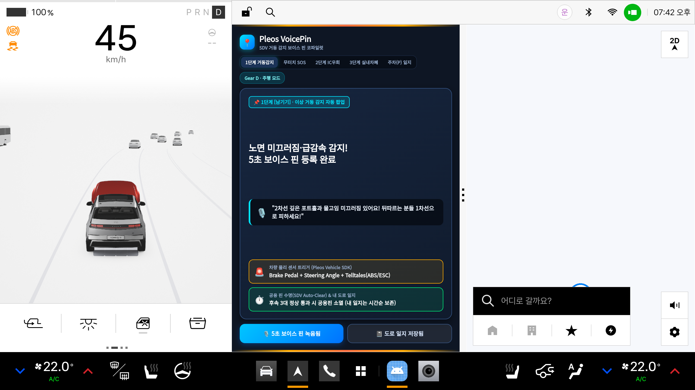
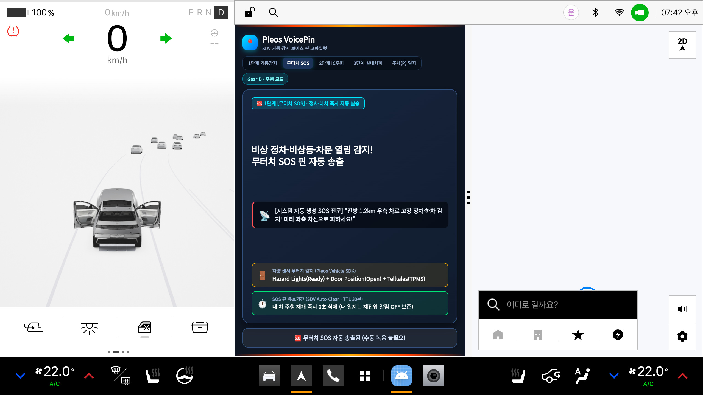
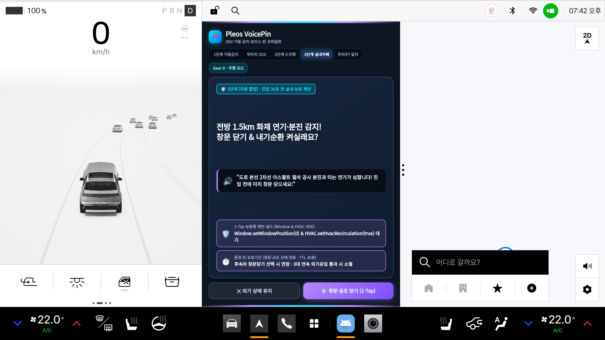
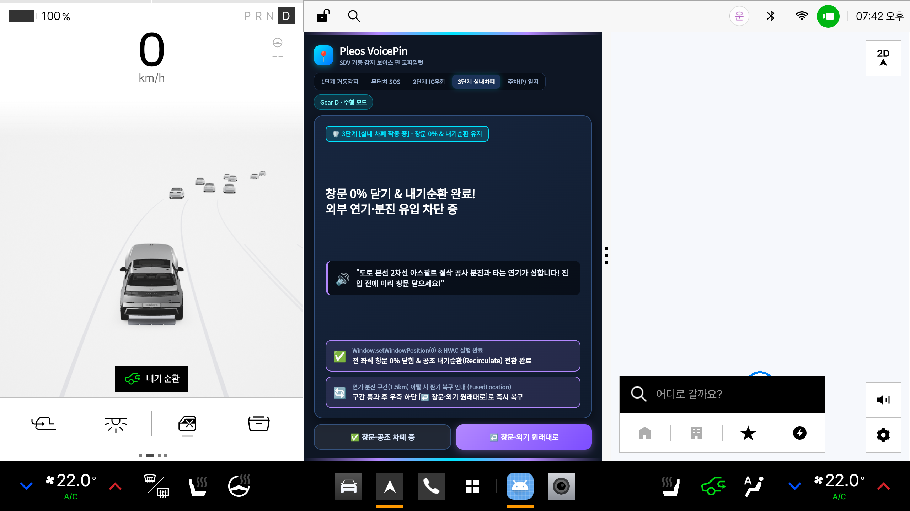
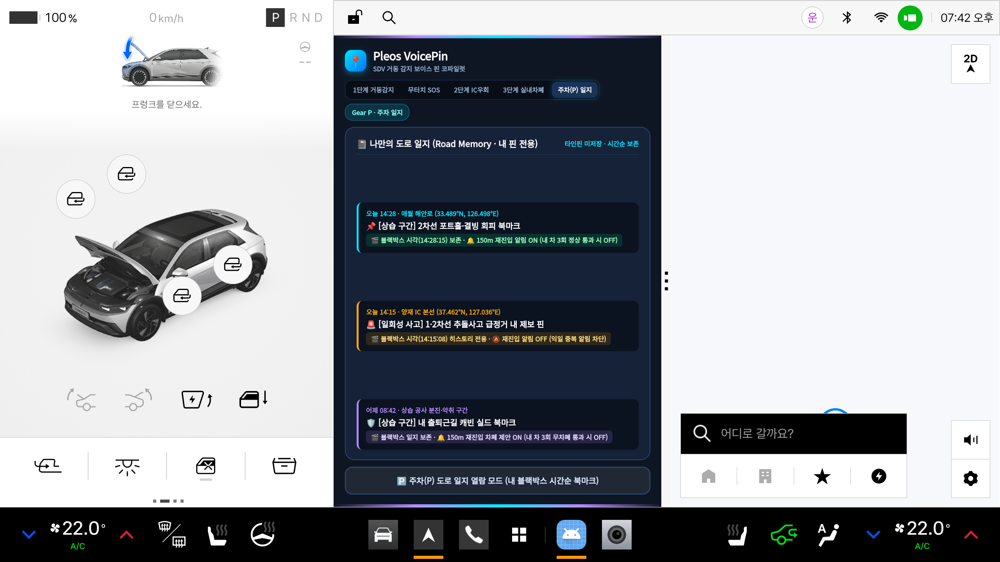

# 1. 앱 이름 / 프로젝트명 (App & Project Name)
**`VoicePin (보이스핀) / SDV 물리 거동 기반 5초 보이스 핀`**  
> **현대자동차그룹 차량용 앱 개발 공모전 (Code your App into Pleos App Market) 출품작**

---

## 2. 앱 한 줄 소개 (One-Line Summary)
내가 겪은 도로 위 급정거·결빙·연기 구간을 차량 센서와 **5초 음성**으로 기록·공유하여, 뒤따르는 운전자가 위험에 갇히기 전에 미리 듣고 피하게 해주는 앱입니다.

* **🎬 시연 영상 (Demo Video)**: 👉 **[`./demo/voicepin_demo.mp4`](./demo/voicepin_demo.mp4)** *(클릭 후 `View raw`를 누르면 브라우저에서 바로 재생·다운로드됩니다)*

---

## 3. 실행 방법 (How to Run)

### ① APK 설치 및 실행 (`Pleos Connect v2.1.0 에뮬레이터`)
```bash
# 1. Virtual Console(8088) 포트 포워딩 및 Release APK 설치
adb forward tcp:8088 tcp:8088
adb install -r apk/이태준_VoicePin_release.apk

# 2. 앱 실행 (또는 앱 서랍에서 'Pleos VoicePin' 아이콘 터치)
adb shell am start --user current -n io.echolab.pleosecholog/.MainActivity
```
* **기본 주행 화면 (`🏠 전방핀 홈`)**: 앱 실행 시 평상시 주행 대기 화면인 **`전방 5km 보이스핀 레이더 (가까운 거리순 리스트: +350m → +1.5km → +4.8km)`**가 먼저 표시되며, 센서 트리거로 상황 팝업이 발생한 뒤 조치가 끝나면 다시 이 기본 홈 화면으로 자동/원탭 복귀합니다.
* **3분할 멀티윈도우(순정 내비게이션 동시 표시) 팁**: 앱 창 우측 끝 중앙의 분할 핸들(`⋮`)을 왼쪽으로 드래그하면 **`좌측 1/3 클러스터 + 중앙 1/3 VoicePin + 우측 1/3 순정 내비게이션`** 3분할 화면으로 나란히 동작합니다.

### ② `Virtual Console (http://localhost:8088)` 시나리오별 동작 확인

| 단계 | Virtual Console (`http://localhost:8088`) 및 테스트 조건 | 에뮬레이터 실시간 동작 결과 |
| :---: | :--- | :--- |
| **① 1단계 거동감지**<br/>*(5초 보이스 핀)* | • `Safety > Telltales (ABS/ESC) = On` 또는<br/>• `Motion > Brake = 75%` + `Steering = -42° (±15° 이상)` | <br/>클러스터 경고등·급회피 제동 감지와 동시에 기본 홈에서 **`1단계 거동감지(5초 보이스 핀)`** 팝업으로 자동 전환 (해제 시 홈 자동 복귀) |
| **② 1-B단계 무터치 SOS**<br/>*(정차 중 비상 하차)* | • `Speed = 0km/h`<br/>• `Convenience > Hazard Lights = On`<br/>• `Door Position = Open` / `TPMS = On` | <br/>비상등·도어 개방·`TPMS` 경고등 연동과 동시에 운전자 조작 없이 **`무터치 SOS 자동 송출`** 팝업으로 전환 (해제 시 홈 자동 복귀) |
| **③ 3단계 실내차폐**<br/>*(브리핑 카드 호출)* | • `Window = 45%`, `HVAC Recirc = Fresh`<br/>• 기본 홈 리스트의 `[🛡️ 실내차폐 제안]` 또는 상단 `[3단계 실내차폐]` 탭 터치 *(내장 SQLite 샘플 핀 호출)* | <br/>전방 1.5km 연기·분진 샘플 핀 호출 시 **`3단계 실내차폐 제안([🛡️ 창문·공조 닫기 (1-Tap)])`** 카드 표시 |
| **④ 3단계 1-Tap 역제어**<br/>*(창문 0% + 내기순환)* | • 카드 하단 **`[🛡️ 창문·공조 닫기 (1-Tap)]`** 터치<br/>(`Window.setWindowPosition(0)` & `HVAC.setHvacRecirculation(true)`) | <br/>좌측 순정 클러스터 하단에 **`🚗 내기 순환` 토스트가 즉시 팝업**되고 전 좌석 창문 `0%` 닫기 완료 |
| **⑤ 주차(P) 도로 일지**<br/>*(블랙박스 북마크)* | • `Motion > Gear Selection = P (Park)` | <br/>기어 `P` 전환 즉시 내가 남긴 핀만 시간순 보존된 **`나만의 도로 일지(Road Memory)`** 화면으로 자동 전환 |

---

## 4. 테스트 환경 및 필요한 설정 (Test Environment & Configuration)
* **Target / Compile SDK**: `Android API 34` (`minSdk 28`)
* **Build System**: `Gradle 8.1.1` / `Android Gradle Plugin 8.0.2`
* **테스트 환경**: `Pleos Connect v2.1.0 에뮬레이터 (API 34, 2560×1440)` 및 `Virtual Console (http://localhost:8088)`
* **사용한 공식 SDK**: `Vehicle (2.3.2)`, `FusedLocation (1.1.3)`, `NaviHelper (3.0.5)`, `SpeechToText (3.3.1)`, `TextToSpeech (3.3.1)`
* **별도 외부 설정 불필요**: 외부 클라우드 DB나 추가 환경 설정 없이 APK 설치 즉시 내장 SQLite 샘플 데이터와 Virtual Console 연동으로 전 기능을 테스트할 수 있습니다.

---

## 5. APK 및 시연 영상 파일 위치 (APK & Demo Video Location)
* **Release APK 경로**: 👉 **[`./apk/이태준_VoicePin_release.apk`](./apk/이태준_VoicePin_release.apk)**
* **시연 영상 경로**: 👉 **[`./demo/voicepin_demo.mp4`](./demo/voicepin_demo.mp4)**

```text
pleos-voicepin/
├── apk/
│   └── 이태준_VoicePin_release.apk           # 서명 완료된 설치형 Release APK
├── demo/
│   └── voicepin_demo.mp4                     # Pleos Connect 에뮬레이터 & Virtual Console 실시간 연동 시연 영상
├── screenshots/                              # 공식 에뮬레이터 5단계 연동 캡처 5종
├── app/
│   ├── build.gradle                          # 공식 Pleos 5대 SDK 의존성 설정
│   └── src/main/
│       ├── AndroidManifest.xml               # 멀티윈도우 및 pleos.car.permission.* 선언
│       ├── assets/pleos_voicepin_hmi.html    # 메인 HMI 레이아웃 에셋
│       └── java/io/echolab/pleosecholog/
│           ├── MainActivity.kt               # 멀티윈도우 및 5대 SDK 통합 컨트롤러
│           ├── sdk/PleosVehicleBridge.kt     # Vehicle SDK (v2.3.2) & Virtual Console 브릿지
│           ├── db/GeoSpatialVoicePinRepository.kt # GeoHash & 로컬 SQLite (WAL) 저장소
│           ├── engine/BlackboxWitnessEngine.kt    # 이상 거동·무터치 SOS·자동 소멸 엔진
│           └── ptt/DualModePttManager.kt     # FusedLocation·NaviHelper·STT/TTS 매니저
├── build.gradle
└── settings.gradle
```
